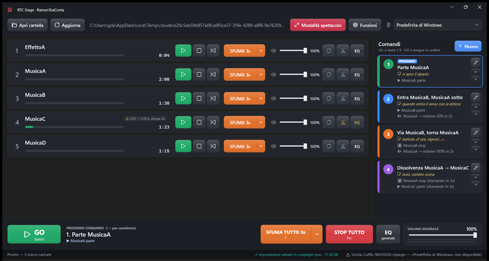
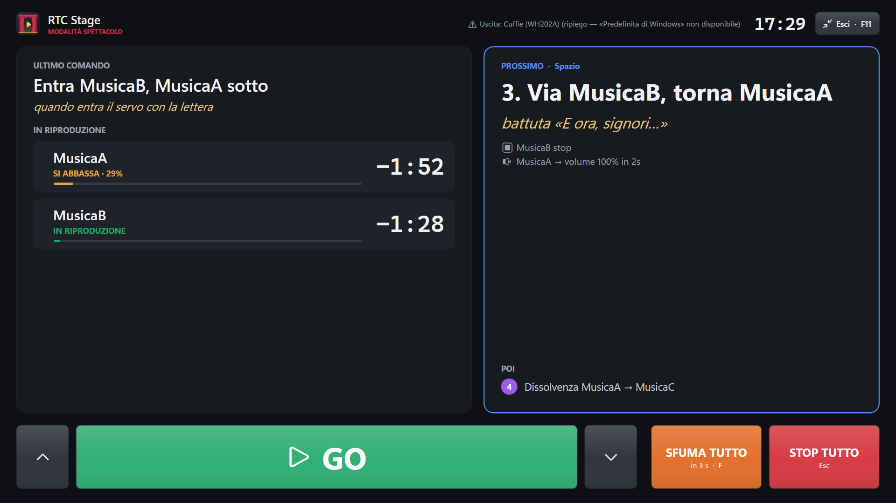

<p align="center"></p>

# RTC Stage

Lettore di musiche per spettacoli teatrali — **RamonTeaConta**.
Windows 10/11, un unico `RTCStage.exe`: nessuna installazione, funziona anche da chiavetta USB e senza internet.

**Manuale completo: [docs/Manuale-RTC-Stage.pdf](docs/Manuale-RTC-Stage.pdf)**



## In breve

- **Apri cartella**: le musiche (MP3, WAV, M4A/AAC, FLAC, WMA, AIFF) compaiono in ordine di nome, caricate in memoria: partono all'istante.
- **Ogni traccia**: ▶/⏸, ⏹, ⏮ da capo, **SFUMA ▾** (durata nel menu), volume, 🔁 loop, ✂ **inizio e fine** (con sfumata finale), **EQ** bassi/medi/alti.
- **Comandi**: pulsanti che crei tu. Per ogni traccia: ▶ **Parte**, 🔉 **Volume** (abbassa o riporta su), ⏸ **Pausa**, ⏹ **Stop**,
  con volume e tempo, più una **nota di regia**. Si lanciano con un clic, con i tasti 1-9 o con **GO** (Spazio), in ordine.
- **Modalità spettacolo** (F11): vista a schermo intero con GO enorme, ultimo comando e prossimo con le note, musiche in corso con il tempo che manca.
- **Avviso di fine traccia**: lampeggio rosso negli ultimi 10 secondi.
- **Funzioni**: ogni strumento si accende o spegne con un interruttore, così la vista resta semplice.
- **EQ generale** a 5 bande, **SFUMA TUTTO**, **STOP TUTTO**; ripiego automatico su un'altra uscita audio se quella scelta non si apre.
- Tutto si salva da solo in `cueplayer.json` dentro la cartella delle musiche.



| Tasto | Azione |
|---|---|
| Spazio | GO (prossimo comando) |
| 1 … 9 | esegue il comando con quel numero |
| ↑ / ↓ | cambia il prossimo comando |
| F | sfuma tutto |
| Esc | stop tutto |
| F11 | modalità spettacolo |

## Sorgenti

`sorgenti/`: C# .NET 8, WPF + [WPF-UI](https://github.com/lepoco/wpfui) (stile Fluent) + [NAudio](https://github.com/naudio/NAudio) (WASAPI).
Mixer sempre attivo con decodifica in memoria, sfumate a potenza costante, EQ biquad (RBJ).

```
dotnet test sorgenti/CuePlayer.Tests
dotnet publish sorgenti/CuePlayer/CuePlayer.csproj -c Release -r win-x64 --self-contained true -p:PublishSingleFile=true -p:IncludeNativeLibrariesForSelfExtract=true -p:EnableCompressionInSingleFile=true -p:DebugType=none -o publish
```

Il manuale si rigenera da `docs/manuale/manuale.html` (Edge/Chrome → Stampa → PDF).
Il logo è vettoriale in `sorgenti/CuePlayer/Assets/Logo.xaml`.
